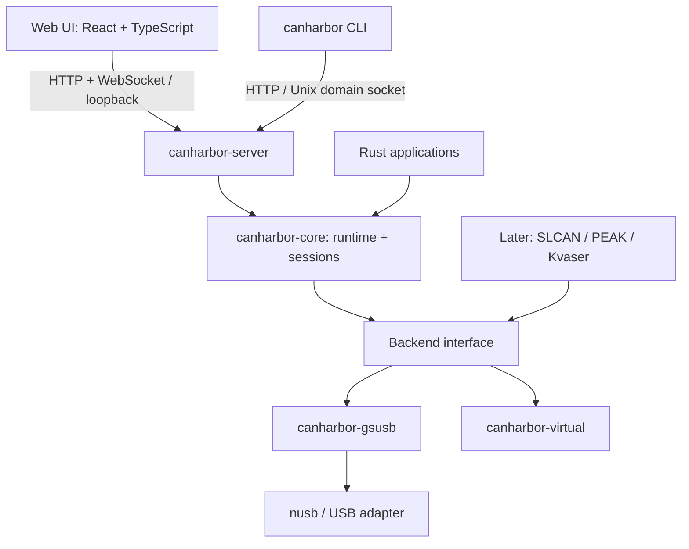

# CANHarbor 技术方案

状态：拟实施。日期：2026-11-05。仓库：<https://github.com/soulteary/canharbor>。

CANHarbor 使用 Rust 构建设备访问与会话核心，以本地服务统一向 CLI 和 Web UI 提供能力。首版围绕 gs_usb 和虚拟后端形成完整链路：设备发现、只听监视、显式授权发送、录制、回放与故障恢复。文中的接口、限额和性能值均为设计约定或验收目标，不代表已有实现或实测结果。

## 1. 已确定的产品边界

- 仓库与可执行文件均为 `canharbor`。
- Rust 包使用 `canharbor-*` 前缀；保留 `canharbor-core`、`canharbor-gsusb`、`canharbor-cli`。
- 使用 Web UI。前端不承担 USB I/O、发送调度或录制可靠性。
- 默认离线可用，无账号、云端依赖、远程字体或 CDN。
- 自有代码与文档采用 AGPL-3.0-or-later；外来内容按原许可处理。
- 首发硬件验证优先 macOS arm64；x86_64 在完成对应实机验收后声明支持。最低 macOS 版本在 M0 用 USB 原型和 CI 固定，不先承诺未经验证的版本。
- 不以兼容 PF_CAN、netlink、系统 vcan 为首版目标；不在首版加入内核扩展、DriverKit、完整 UDS 或 CAN XL。

## 2. 进程与依赖



正式使用入口为 `canharbor serve --open`：前台运行一个用户级服务，绑定受限本地端口和 Unix domain socket（UDS），打开浏览器配对页面。`--no-web` 只开启 UDS。CLI 设备操作连接该服务，服务未启动时给出启动命令，不暗中启动后台进程。`canharbor web open` 经 UDS 请求新的一次性浏览器配对入口。

每个 macOS 用户只有一个默认服务实例。运行目录为 `$TMPDIR/canharbor-<uid>/`，验证目录所有者、拒绝符号链接、权限设为 0700；socket 为 0600。持有服务锁后再创建 socket；不能只看 PID 文件，也不能随意删除未知 socket。UDS 在接受请求前验证 peer UID。CLI 不从命令行或配置文件接收任意远程 API 地址。

Rust SDK 可以嵌入应用并直接实例化核心，不强制依赖服务。但直接访问与本地服务不能同时拥有同一 USB 接口；遇到 busy 返回明确诊断。首版 CLI 不提供绕过服务的 direct 模式，从源头减少所有权冲突。

服务和 CLI 使用同一个二进制，`canharbor-cli` 声明 `[[bin]] name = "canharbor"`。首版不拆出第二个 daemon 可执行文件，也不自动安装 launchd 服务。

## 3. Workspace 规划

```text
canharbor/
├── Cargo.toml                    # 后续实现时创建，统一包元数据
├── crates/
│   ├── canharbor-core/           # 帧、能力、Backend trait、事件与会话
│   ├── canharbor-gsusb/          # gs_usb 编解码、USB 与固件 quirks
│   ├── canharbor-virtual/        # 确定性的虚拟总线与故障注入
│   ├── canharbor-server/         # Axum、UDS/HTTP、认证、API DTO
│   └── canharbor-cli/            # clap 命令、服务客户端与程序入口
├── web/                         # React + TypeScript + Vite
├── docs/                        # 设计、API、ADR、许可与硬件矩阵
├── tests/fixtures/              # 自制且来源清晰的协议向量
└── xtask/                       # 后续构建 Web、打包与版本核对
```

`core` 的模型放在独立模块，保持不依赖 USB、HTTP、前端和后端实现。运行时使用 Tokio；Backend trait 和核心运行时同属 `core`，后端依赖 `core`，由 CLI 的 composition root 注册后端，避免反向依赖。首版通过静态注册与 Cargo feature 选择后端，不做动态插件 ABI。

`server` 包含带版本的网络 DTO，禁止直接把核心内部结构序列化为长期 API。以后有独立 Rust 远程客户端需求再拆 `canharbor-api` / `canharbor-client`。C ABI 和 Python 绑定在模型稳定后新增 `canharbor-ffi`，不挤入首版。

前端 `web` 是一个由 Bun 管理的独立前端包，不叫 Rust crate。先不为每个过滤器、队列或文件格式单独建 crate。

## 4. 技术选型

Rust 核心使用 Tokio、serde、thiserror 和 tracing；CLI 使用 clap；USB 优先采用 nusb；本地服务使用 Axum 与 tower-http。Web UI 采用 React、TypeScript、Vite，使用原生 fetch/WebSocket，按需要加入虚拟列表和图表库。前端不使用 SSR、Next.js 或浏览器 WebUSB。

这些是依赖方向，版本在 M0 解析并固定于 Cargo.lock、前端 lockfile 与工具链文件。禁止从 upstream main 拉取未发布框架版本；例如 Axum 当前 main 明示含下一版破坏性变更，应选已发布版本并核对相应文档。首次只启用实际需要的 feature。

开发使用 Vite，发行前将静态资源编入 Rust 发行二进制。Node.js 只参与前端开发与发行构建，不是用户运行时依赖。SDK 核心构建不触发前端构建。带 Web 的构建缺少资源时必须失败，不能悄悄发出空白 UI。

## 5. 数据模型与后端契约

### 5.1 帧与事件

使用校验过的 `CanId` 和区分类型的 `Frame`：`ClassicData`、`ClassicRemote`、`FdData`。标准 ID 为 0..0x7ff，扩展 ID 为 0..0x1fffffff。构造器拒绝越界，不做静默截断。FD 禁止 RTR；BRS 只在 FD 中存在；ESI 接收状态与发送能力分别处理。

Classic 数据帧负载最多 8 字节。Classic RTR 存储请求 DLC，不携带数据。FD 首版只接受 0..8、12、16、20、24、32、48、64 这些线上长度；需要填充的调用方显式指定 padding 并得到最终线上帧。这样避免“发送 9 字节”被无提示改为 12 字节。原始 DLC 与实际解码长度分别保留。

事件包括 `FrameReceived`、`TxUpdated`、`BusStateChanged`、`DeviceRemoved`、`Gap`、`CaptureStateChanged`。错误状态不能伪装成正常数据帧；接收到的 gs_usb 错误帧保留原始载荷及可解析状态。Classic DLC 9..15 等设备差异以明确能力/quirk 处理，不默认为普通 0 字节帧。

### 5.2 后端接口

Backend 提供枚举和打开设备；每个打开设备提供能力、通道配置、启动/停止、提交发送、事件读取和关闭。接口具体签名在 M0 的两个后端原型后确定；不得为支持 Rust trait object 引入未经验证的泛型组合。

能力同时包含设备、通道和当前模式限制：Classic/FD、位时序范围、时钟、ISO FD、listen-only、loopback、硬件时间戳、硬件过滤、发送确认类型。未知与明确不支持是不同结果。软件过滤不能被 UI 标为硬件过滤；不存在的能力返回 `unsupported`。

`send` 返回提交 receipt，不等于成功上总线。发送阶段为 `queued`、`submitted`、`confirmed`、`failed` 或 `outcome_unknown`。只有后端能证明相应语义时才标 confirmed；echo 的确认含义要按后端说明，不能统一当作目标 ECU 收到数据。

### 5.3 身份与时间

设备键由后端、VID/PID、序列号和接口组成；通道再加设备内 channel index。没有可靠序列号时提供运行期 ID 并标注不稳定，不承诺跨重插保持。内部 UUID 与可读标签分开，持久配置不可只依赖 USB address。

每次设备打开生成 epoch。记录原始设备时间、扩展设备时间、host monotonic 时间和质量标识；host monotonic 只在服务实例内有意义。UTC 只用于文件元数据与外部显示锚点。32 位微秒计数器约 71.6 分钟回绕，遇到长空闲、乱序或设备复位不能强行按普通回绕扩展，应切换 epoch 或标为不确定。

每通道事件有递增 sequence。服务重启后用新 `server_instance_id`，客户端不能跨实例续接旧序列。

## 6. USB 与并发

每个物理 USB 设备由一个 actor 拥有接口、端点和取消状态；所有通道共享该设备的接收解析器，再根据 channel 分发。通道对象不能各自抢读同一个 bulk IN。配置、关闭与 TX 通过有界命令队列串行化到设备 actor。

使用描述符发现端点及 alternate setting，结合受控 VID/PID 表与固件 quirks。未知设备需要显式 opt-in，不向所有 vendor-specific 接口发送探测命令。严格验证控制响应长度、bulk 消息边界、DLC、channel 与 feature，不通过 Rust packed struct 强转裸字节。

根据 nusb 原型确定多笔在途接收深度，并支持取消与排空；初始探索 4..16 笔，不把该范围写成固定性能事实。解析器必须遵循实际固件的消息边界约定，不能假定一次 transfer 永远等于一帧，也不能在没有长度信息时猜测任意拼包格式。

采集与 GUI、日志、录制分别有有界队列。慢订阅者不能阻塞 USB。统计区分设备溢出、协议解析错误、订阅队列丢弃、录制队列丢弃；无法知道设备丢失数量时用 unknown，不能编造精确 sequence gap。

## 7. 会话状态与控制权

通道状态：`closed → opening → configured → running`；stop 经过 `stopping` 返回 `configured`，close 再释放资源进入 `closed`。`configured` 表示已打开且停止，UI 可显示“已停止”，API 不另造 `stopped` 状态。故障进入 `faulted`，拔插进入 `disconnected`。`bus_off` 是总线子状态，不能与设备断开混为一谈。`opening` / `stopping` 超时后显式失败并回收可回收资源。

每通道最多一个硬件会话，可以挂接多个观察者。创建会话只保留资源并返回 configured 状态；控制者取得 lease 后才能 start、stop、reconfigure、send 或发起主动回放。初始配置默认 listen-only；后端不支持时要求显式选择主动模式，不能静默降级。listen-only 会话拒绝发送；切换主动模式需要 configured 状态及有效 lease。

控制 lease 绑定 client 与 session，初始 TTL 15 秒、每 5 秒续租，带单调 fencing generation。服务在实际下发操作前重新验证 generation；其他页面不能仅拿到 session ID 就发送。租约到期、退出、会话关闭、断开、睡眠恢复都清空尚未提交的 TX 并停止周期任务。已交给硬件的帧未必可撤回，必须在结果中保留未知状态。

lease 到期后服务尝试 stop 通道并进入需要人工重新启动的状态。不能假设支持在运行中无损切换 listen-only，也不能声称任意故障后硬件绝不继续活动。停止失败显示故障。普通观察者关闭不会停止其他客户端的会话；服务拥有的录制可独立持续。

WebSocket 中断不以 TCP 状态推断用户是否存在；以显式注销和 lease 到期为确定边界。浏览器刷新、网络重连、服务重启、设备重插都不自动恢复发送或回放。

## 8. 流式数据、录制与回放

WebSocket 先使用批量 JSON，不引入二进制协议。每批最多 256 个事件或 128 KiB，正常负载下等待最多 20ms；先触达任一限额即发送。单客户端 pending 队列最多 4096 事件或 4 MiB，取更早达到者。总连接数、通道数和录制任务也有限额，避免仅靠每队列上限推导总内存。

UI 显示使用独立采样/聚合，不影响服务端录制。流畅性目标为普通刷新 10..20Hz、行虚拟化与有界历史。前端暂停只暂停显示；停止采集和停止录制是独立动作。

首版录制格式为带 schema 版本的 NDJSON：文件头、逐事件、结束摘要。64 位序号和纳秒使用十进制字符串。每文件只含同一 schema major；滚动、flush 和崩溃恢复策略明确。服务生成文件名和 capture ID，不允许浏览器提交任意磁盘路径。

录制队列满时记录 gap、置 incomplete；默认结束录制并保存可读前缀，不能显示“完整保存”。磁盘错误也必须成为任务失败。Web 下载走受鉴权的 capture ID，正确转义文件名。以后添加常见 candump 子集导入导出，明确不能保真保存的字段。

“查看回放”只在虚拟/离线时间线上运行；“发送回放”会实际发帧，要求主动模式、控制 lease、速率上限、开始确认和服务端停止入口。单帧发送进入 v0.1，周期发送与主动回放在 v0.2 验收，调度基于 Rust 单调时钟，浏览器不负责周期定时。

## 9. 打包与可观察性

`serve` 支持 graceful shutdown：停止接收新控制操作、撤销租约、取消调度、关闭设备、完成有限时长的录制 flush、移除本实例运行文件。超时输出未完成任务，不无限等待。

诊断以结构化 tracing 和稳定错误码为基础；`doctor` 输出版本、架构、后端、设备能力、权限、端点/固件信息、队列与丢失统计。默认不记录 CAN payload、配对码、cookie、CSRF 值或完整设备序列号。用户主动导出 payload 时提示其包含业务数据。

release 包含 CLI、编入的 UI、LICENSE/第三方声明、版本 manifest、对应源码包与校验值。Web UI 的 About 显示服务/UI/API 版本、提交和对应源码。UI 和服务版本不匹配时禁用控制操作并要求刷新，API major 不匹配拒绝连接。

## 10. 官方参考

- [nusb](https://github.com/kevinmehall/nusb)：USB API 与平台支持。
- [Tokio](https://github.com/tokio-rs/tokio)：运行时与任务管理。
- [Axum](https://github.com/tokio-rs/axum)：本地 HTTP/WS 服务，实施时使用已发布分支文档。
- [Vite](https://github.com/vitejs/vite)：开发与静态构建。
- [前期 gs_usb 参考快照](https://github.com/sorrowfeng/gsusb-canfd/tree/6785cc82d66da93cb3ff5af66a6b3498f1118c66)：协议与测试研究；新实现先核查实际借入片段来源。

其他上游的复用条件见 [licensing.md](licensing.md)，数据与本地访问契约见 [api-design.md](api-design.md) 和 [web-ui.md](web-ui.md)。
